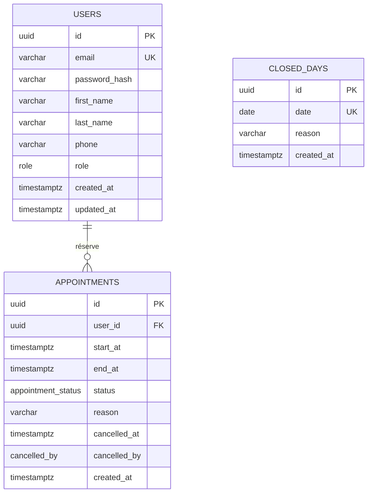

# Modèle de données

SGBD : PostgreSQL 16. Schéma géré par Prisma (`api/prisma/schema.prisma`), migrations versionnées dans `api/prisma/migrations/`.

## 1. MCD



`CLOSED_DAYS` n'a pas de relation : c'est une liste de dates fermées.

## 2. Types énumérés

| Type | Valeurs |
|---|---|
| `role` | `PATIENT`, `ADMIN` |
| `appointment_status` | `BOOKED`, `CANCELLED` |
| `cancelled_by` | `PATIENT`, `ADMIN` |

## 3. Tables

### `users`

| Colonne | Type | Contraintes |
|---|---|---|
| `id` | `uuid` | PK, `DEFAULT gen_random_uuid()` |
| `email` | `varchar(255)` | `NOT NULL`, `UNIQUE`, stocké en minuscules |
| `password_hash` | `varchar(255)` | `NOT NULL` |
| `first_name` | `varchar(100)` | `NOT NULL` |
| `last_name` | `varchar(100)` | `NOT NULL` |
| `phone` | `varchar(20)` | `NOT NULL` |
| `role` | `role` | `NOT NULL`, `DEFAULT 'PATIENT'` |
| `created_at` | `timestamptz` | `NOT NULL`, `DEFAULT now()` |
| `updated_at` | `timestamptz` | `NOT NULL`, mis à jour par Prisma |

### `appointments`

| Colonne | Type | Contraintes |
|---|---|---|
| `id` | `uuid` | PK, `DEFAULT gen_random_uuid()` |
| `user_id` | `uuid` | `NOT NULL`, FK → `users.id` `ON DELETE CASCADE` |
| `start_at` | `timestamptz` | `NOT NULL` |
| `end_at` | `timestamptz` | `NOT NULL`, `CHECK (end_at > start_at)` |
| `status` | `appointment_status` | `NOT NULL`, `DEFAULT 'BOOKED'` |
| `reason` | `varchar(500)` | nullable |
| `cancelled_at` | `timestamptz` | nullable |
| `cancelled_by` | `cancelled_by` | nullable |
| `created_at` | `timestamptz` | `NOT NULL`, `DEFAULT now()` |

Contraintes supplémentaires :

```sql
-- R1 : un créneau n'est réservé qu'une fois (les annulés ne comptent pas)
CREATE UNIQUE INDEX appointments_slot_booked_uq
  ON appointments (start_at)
  WHERE status = 'BOOKED';

-- Uniquement le mercredi (0 = dimanche, 3 = mercredi), heure de Paris
ALTER TABLE appointments ADD CONSTRAINT appointments_wednesday_ck
  CHECK (EXTRACT(DOW FROM start_at AT TIME ZONE 'Europe/Paris') = 3);

-- Cohérence de l'annulation
ALTER TABLE appointments ADD CONSTRAINT appointments_cancel_ck
  CHECK (
    (status = 'BOOKED'    AND cancelled_at IS NULL     AND cancelled_by IS NULL) OR
    (status = 'CANCELLED' AND cancelled_at IS NOT NULL AND cancelled_by IS NOT NULL)
  );

-- Accélère "mes rendez-vous"
CREATE INDEX appointments_user_start_idx ON appointments (user_id, start_at);
```

Prisma ne sait pas déclarer les index partiels et les `CHECK` : ils sont ajoutés à la main dans le fichier SQL de la migration.

La règle R4 (un rendez-vous par mercredi et par patient) est vérifiée dans le service, à l'intérieur d'une transaction.

### `closed_days`

| Colonne | Type | Contraintes |
|---|---|---|
| `id` | `uuid` | PK, `DEFAULT gen_random_uuid()` |
| `date` | `date` | `NOT NULL`, `UNIQUE`, `CHECK (EXTRACT(DOW FROM date) = 3)` |
| `reason` | `varchar(255)` | nullable |
| `created_at` | `timestamptz` | `NOT NULL`, `DEFAULT now()` |

## 4. Choix de suppression

| Relation | `ON DELETE` | Pourquoi |
|---|---|---|
| `appointments.user_id` → `users.id` | `CASCADE` | R11 (RGPD) : supprimer le compte supprime ses rendez-vous |

## 5. Données initiales (seed)

- Un utilisateur `ADMIN` créé à partir de `ADMIN_EMAIL` / `ADMIN_PASSWORD`. Le seed est idempotent (upsert).
- En développement uniquement : quelques patients et rendez-vous de démonstration.

## 6. Base de test

La CI utilise une base PostgreSQL éphémère. Avant les tests d'intégration : `prisma migrate deploy`, puis les tables sont vidées entre chaque fichier de test.
